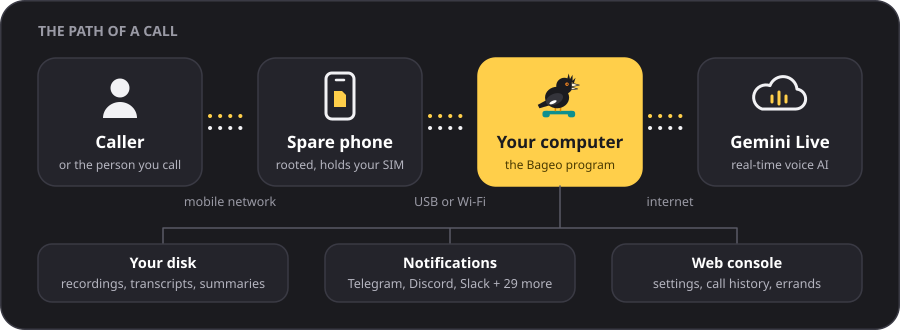

  

  <a href="README.md">English</a> · <a href="README.zh-TW.md">繁體中文</a> · <a href="README.zh-CN.md">简体中文</a> · <a href="README.ja.md">日本語</a> · <a href="README.ko.md">한국어</a> · <a href="README.es.md">Español</a> · <strong>Français</strong> · <a href="README.de.md">Deutsch</a> · <a href="README.pt.md">Português</a>

  <strong>Assistant téléphonique IA pour votre vrai numéro : Gemini Live répond à vos appels et passe les vôtres.</strong> 
  Auto-hébergé et open source. Votre propre téléphone sans root (iPhone ou Android), associé à un ordinateur Linux avec Bluetooth, un programme sur votre ordinateur, votre propre clé Gemini.

  
  
  
  

> **Édition Bluetooth, en développement.** Bageo par Bluetooth : un ordinateur Linux avec Bluetooth répond aux appels de votre téléphone comme le fait une voiture, donc le téléphone n'a besoin ni de root ni d'appli, et l'iPhone fonctionne aussi. Cette édition n'inclut ni les SMS ni l'appel à trois d'urgence. Installation : [bluetooth/README.md](bluetooth/README.md) (en anglais).

<table>
  <tr>
    <td width="25%" align="center" valign="top">
       
      <strong>Répond à vos appels</strong> 
      Décroche après une sonnerie, parle comme une vraie personne et attend que l’appelant dise au revoir.
    </td>
    <td width="25%" align="center" valign="top">
       
      <strong>Fait traîner les arnaqueurs</strong> 
      Repère le démarchage et les arnaques, puis joue un client lent et curieux, jusqu’à 30 minutes.
    </td>
    <td width="25%" align="center" valign="top">
       
      <strong>Passe vos appels</strong> 
      Écrivez une ligne et il appelle à votre place. En cas de doute, il vous demande d’abord.
    </td>
    <td width="25%" align="center" valign="top">
       
      <strong>Parle neuf langues</strong> 
      Anglais, chinois traditionnel, chinois simplifié, japonais, coréen, espagnol, français, allemand et portugais. Il change de langue quand l’appelant change.
    </td>
  </tr>
</table>

Le nom vient de bāgē (八哥), le martin huppé, un oiseau qui apprend à parler comme les gens avec qui il vit.

## À essayer : devinez ce que dit Bageo

Ouvrez un appel, puis avancez ligne par ligne. Exemples écrits d’avance, pas de vrais enregistrements.

<strong>Livraison de colis</strong> — Un colis arrive alors que vous êtes occupé.

 

> <strong>Appelant</strong> : Votre colis est arrivé.

Que dit Bageo ?

 

> <strong>Bageo</strong> : Bonjour, je suis un assistant IA et je réponds à ce téléphone. Faut-il une signature en main propre ?
>
> <strong>Appelant</strong> : Oui. Nous pouvons repasser avant 17 h cet après-midi.

Et ensuite ?

 

> <strong>Bageo</strong> : Je transmets et je demande au destinataire de confirmer un horaire.

<strong>Ce que vous obtenez :</strong> Signature nécessaire ; une nouvelle livraison est possible avant 17 h. Vous confirmez l’horaire.

<strong>Démarchage</strong> — Une « offre exceptionnelle » vous appelle.

 

> <strong>Appelant</strong> : Vous êtes éligible dès aujourd’hui à un crédit à taux réduit !

Bageo raccroche-t-il ?

 

> <strong>Bageo</strong> : Ce taux d’intérêt est-il mensuel ou annuel ?
>
> <strong>Appelant</strong> : Donnez-moi d’abord vos informations personnelles.

Bageo les donne-t-il ?

 

> <strong>Bageo</strong> : Comment calculez-vous les frais ? À combien s’élèvent les mensualités ?

<strong>Ce que vous obtenez :</strong> Aucune information personnelle communiquée, et les questions s’enchaînent. Bageo peut occuper un appelant comme celui-ci jusqu’à 30 minutes.

<strong>Réserver une table</strong> — Une consigne. Un appel de moins.

 

> <strong>Vous</strong> : Réservez quatre places demain à 19 h. 19 h 30, c’est bien aussi.

Comment Bageo commence-t-il ?

 

> <strong>Bageo</strong> : Bonjour, je suis un assistant IA et j’appelle pour réserver une table pour quatre demain à 19 h.
>
> <strong>Restaurant</strong> : C’est complet à 19 h. Nous avons une table à 19 h 30.

Bageo accepte-t-il ?

 

> <strong>Bageo</strong> : 19 h 30, ça convient. Réservez pour quatre, merci.
>
> <strong>Restaurant</strong> : C’est confirmé : demain à 19 h 30, quatre personnes.

<strong>Ce que vous obtenez :</strong> Demain, 19 h 30, quatre personnes, dans les limites que vous avez fixées. Pour tout ce qui sort de vos consignes, Bageo vous demande d’abord.

## Un arnaqueur appelle. Bageo le fait parler.

  

Dès qu’un appel est clairement du démarchage ou une arnaque, l’IA devient un client intéressé, lent et facilement distrait. Elle s’informe sur chaque détail, comprend de travers les chiffres et n’en donne jamais un vrai, pendant 30 minutes au plus. Vous recevez l’enregistrement, la transcription et un court résumé. Les appels honnêtes sont laissés tranquilles : une banque qui vérifie un paiement par carte, une clinique, un livreur, la famille. L’option « Les faire parler » est activée par défaut et un seul interrupteur la désactive. [Comment fonctionne le tri des appels](docs/en/FEATURES.md#spam-and-scam-call-blocker-with-stall-mode)

## Pas envie d’appeler ? Écrivez une ligne.

  

Réserver une table, déplacer un rendez-vous, demander à un magasin s’il a un article en stock ou quels sont ses horaires. Quand l’interlocuteur aborde un point que vous n’aviez pas prévu, l’IA vous pose la question à l’écran avant de répondre. Elle n’accepte jamais rien de son propre chef : si vous ne répondez pas à temps, elle dit que vous confirmerez et met fin à l’appel poliment. [En savoir plus sur les appels IA](docs/en/FEATURES.md#ai-errands-it-makes-calls-for-you)

## Un appelant de l’étranger ? Bageo parle neuf langues.

  

La voix de l’IA, les prompts intégrés (une base courte et générale que vous pouvez adapter à votre situation et à votre style), la console web et les notifications existent en neuf langues. Sur un téléphone à double SIM, chaque SIM ouvre les appels dans sa propre langue, un appelant de l’étranger entend la langue de son pays, et si l’appelant change de langue en cours d’appel, l’IA suit. Les transcriptions gardent les mots d’origine, chaque ligne avec une traduction dans la langue de vos notifications. [En savoir plus sur les langues et la double SIM](docs/en/FEATURES.md#nine-languages-dual-sim-translated-transcripts)

## Comment ça marche

  

Le téléphone ne fait que transporter l’appel ; tout le reste tourne sur votre propre ordinateur. L’IA se connecte pendant que le téléphone sonne encore : son premier mot arrive donc environ **0.43 s** après le décroché (médiane mesurée). Un appel, pas à pas : [Architecture](docs/en/ARCHITECTURE.md).

## Pourquoi Bageo

| | Services téléphoniques IA sur trunk SIP ou numéros virtuels | Bageo |
|---|---|---|
| **Numéro** | Un numéro fourni par le service, ou vos appels qui lui sont transférés | Le numéro que vous avez déjà. Les appels sortants l’affichent aussi. |
| **Coût** | Un abonnement ou un tarif à la minute | Aucun frais de plateforme. Vous payez Google pour l’usage de Gemini et votre opérateur pour la SIM. |
| **Vos données** | Sur les serveurs du service | De simples fichiers dans un dossier `data/` sur votre propre disque |
| **Le hic** | Inscrivez-vous et c’est parti | Il faut un ordinateur Linux avec Bluetooth près de votre téléphone et un ordinateur qui reste allumé |

## Et ce n’est pas tout

<table>
  <tr>
    <td width="33%" align="center" valign="top">
       
      <strong>Les rendez-vous vous attendent</strong> 
      Avec « Rendez-vous » activé, un appelant qui veut fixer un horaire atterrit dans votre liste « À traiter ». Vous acceptez ou refusez ; l’IA le rappelle.
    </td>
    <td width="33%" align="center" valign="top">
       
      <strong>Sait qui appelle</strong> 
      Importez vos contacts depuis un vCard, Excel, un PDF ou la photo d’une carte de visite. Classez chaque personne dans l’une de quatre listes : contact, liste blanche, liste noire ou « Les faire parler ».
    </td>
    <td width="33%" align="center" valign="top">
       
      <strong>Un interrupteur pour redevenir un téléphone normal</strong> 
      Passez de l’IA au téléphone ordinaire depuis la console. En mode téléphone ordinaire, les appels restent sur votre téléphone.
    </td>
  </tr>
  <tr>
    <td width="33%" align="center" valign="top">
       
      <strong>Comme un vrai appel</strong> 
      Fond sonore facultatif : maison, bureau, rue, marché de nuit et huit autres.
    </td>
    <td width="33%" align="center" valign="top">
       
      <strong>32 canaux de notification</strong> 
      Un résumé après chaque appel sur Telegram, Discord, Slack, LINE et d’autres. Agissez d’un geste depuis la notification, ou envoyez des commandes depuis le chat.
    </td>
    <td width="33%" align="center" valign="top">
       
      <strong>Vos données restent à vous</strong> 
      Enregistrements et transcriptions sont de simples fichiers sur votre propre disque. Aucun compte chez nous.
    </td>
  </tr>
</table>

Toutes les fonctions en détail : [Fonctionnalités](docs/en/FEATURES.md).

## Ce qu’il vous faut

1. **Un téléphone avec votre SIM**, iPhone ou Android. Ni root ni appli.
2. **Un ordinateur Linux avec Bluetooth** près du téléphone (environ 10 m) : Debian, Ubuntu ou Raspberry Pi OS. Ce peut être celui qui fait tourner Bageo.
3. **Un ordinateur qui fait tourner Bageo** tant que les appels doivent être décrochés : Windows 10/11, macOS, Linux ou Docker.
4. **Une clé API Gemini** de [Google AI Studio](https://aistudio.google.com/apikey). Google facture à l’usage.

## Démarrage rapide

L’ordinateur Bluetooth doit être sous Linux ; Bageo lui-même tourne aussi sous Windows, macOS et Docker.

1. **Téléchargez** le fichier pour votre système depuis [Releases](https://github.com/h4lo-void/bageo-call-bluetooth/releases) : `bageo-call-bluetooth-<version>-windows-x64-setup.exe` pour Windows, `bageo-call-bluetooth-<version>-macos-arm64.dmg` (puce Apple) ou `bageo-call-bluetooth-<version>-macos-x64.dmg` (Intel) pour macOS, `bageo-call-bluetooth-<version>-linux-x64.tar.gz` pour Linux. Pour Docker, construisez-le depuis ce dépôt avec `docker compose up -d --build`.
2. **Installez-le et lancez-le.** Windows : double-cliquez sur `setup.exe`, puis sur le raccourci **Bageo** du bureau. macOS : ouvrez le `.dmg`, glissez Bageo dans *Applications* et cliquez dessus. Linux : décompressez puis lancez `./start.sh`. La console s’ouvre sur <http://localhost:8787/> ; une fois un mot de passe défini, <http://bageo.local/> fonctionne aussi sur cet ordinateur et sur le même réseau Wi-Fi.
3. **Renseignez l’essentiel** sous **Réglages** : votre clé API Gemini, votre nom et la langue. Appuyez sur ▶ pour écouter les voix et en choisir une.
4. **Connectez le téléphone** une seule fois : sur l’ordinateur Bluetooth, lancez `sudo ./bluetooth/install.sh` (il est dans le téléchargement Linux), puis associez votre téléphone. Si Bageo tourne sur un autre ordinateur ou dans Docker, reliez les deux avec un code d’association de la console. Détails : [bluetooth/README.md](bluetooth/README.md) (en anglais).
5. **Appelez-le** depuis un autre téléphone : une sonnerie, et l’IA décroche.

Bloqué ? Chaque étape en détail : [Démarrage](docs/en/GETTING_STARTED.md) · [Configuration du téléphone (en anglais)](bluetooth/README.md).

## Documentation

Pour l’instant, les documents détaillés sont en anglais.

| | |
|---|---|
| **Démarrer** | [Démarrage](docs/en/GETTING_STARTED.md) · [Configuration du téléphone (en anglais)](bluetooth/README.md) · [Dépannage et FAQ](docs/en/TROUBLESHOOTING.md) |
| **Utiliser** | [Fonctionnalités](docs/en/FEATURES.md) · [Commandes de chat et contrôle des notifications](docs/en/CHAT_COMMANDS.md) · [Rédiger le prompt](docs/en/PROMPTS.md) · [Référence des réglages](docs/en/SETTINGS.md) · [Notifications](docs/en/NOTIFICATIONS.md) |
| **Aller plus loin** | [Architecture](docs/en/ARCHITECTURE.md) · [API](docs/en/API.md) · [MCP](docs/en/MCP.md) · [Feuille de route](docs/en/ROADMAP.md) · [Journal des modifications](CHANGELOG.md) · [`bluetooth/` (en anglais)](bluetooth/README.md) |
| **Mentions légales** | [Confidentialité, sécurité et droit](docs/en/PRIVACY_AND_LEGAL.md) · [Avertissement juridique et conditions d’exploitation](LEGAL.md) · [Double licence et licence commerciale](COMMERCIAL_LICENSE.md) · [Audit de sécurité et de conformité du projet](AUDIT_REPORT.md) |

**État des tests :** plus de 1 400 tests automatisés en CI, 234 appels simulés en 28 langues, et de vrais appels en Bluetooth sur un Pixel 9. [Détails](docs/en/FEATURES.md#test-status). Les retours sur d’autres téléphones et d’autres langues aident le plus : [CONTRIBUTING.md](CONTRIBUTING.md) (en anglais).

## FAQ

<strong>Une IA peut-elle répondre aux appels sur mon numéro actuel ?</strong>

Oui, c’est à cela que sert Bageo. Votre téléphone s’associe en Bluetooth à un ordinateur Linux, comme avec une voiture : l’IA répond aux appels vers votre numéro et appelle depuis celui-ci. En mode téléphone ordinaire, les appels restent sur le téléphone.

<strong>Est-ce que ça marche sans root, ou sur un iPhone ?</strong>

Oui. Le téléphone n’a besoin ni de root ni d’appli, et l’iPhone comme Android fonctionnent. Bageo utilise le kit mains libres Bluetooth, comme une voiture.

<strong>Quels téléphones et ordinateurs sont pris en charge ?</strong>

Un téléphone qui s’associe au kit mains libres d’une voiture devrait fonctionner. De vrais appels ont été testés avec un Google Pixel 9 ; l’iPhone s’associe aussi, mais il a été moins testé. L’ordinateur Bluetooth doit tourner sous Linux (Debian, Ubuntu ou Raspberry Pi OS) ; Windows et macOS ne peuvent pas jouer ce rôle, mais Bageo y fonctionne. Voir [la configuration Bluetooth](bluetooth/README.md) (en anglais).

<strong>Combien coûte son fonctionnement ?</strong>

Bageo est gratuit pour un usage personnel et open source sous `AGPL-3.0-only` (les exploitants en source fermée ou en hébergement commercial ont besoin d’une [licence commerciale](COMMERCIAL_LICENSE.md)). Google facture l’audio de Gemini Live à l’usage, pour
chaque appel que l’IA traite, entrant ou sortant ; les résumés sont de petites
requêtes texte envoyées au modèle Gemini le moins cher. Les aperçus de voix et
l’annonce de numéro bloqué sont préenregistrés et ne coûtent rien. Ajoutez votre
forfait mobile et l’électricité de l’ordinateur, et fixez un budget dans votre
compte Google si vous voulez un plafond.

<strong>Est-il légal de laisser une IA répondre à mes appels ?</strong>

Cela dépend du lieu où vous et votre interlocuteur vous trouvez. L’enregistrement
des appels, l’information sur l’IA et les appels sortants automatisés ont chacun
leurs règles. Le style *Assistant IA* dit qu’il est une IA dès la première
phrase ; *À ma place* parle comme vous sans dire qu’il est une IA. Lisez
[Confidentialité, sécurité et droit](docs/en/PRIVACY_AND_LEGAL.md) avant de
l’activer.

<strong>Est-ce que ça marche hors ligne ou sans Google ?</strong>

Non. La voix en direct est Gemini Live, qui exige une connexion internet et une
clé Gemini. Les résumés peuvent tourner sur un modèle local via Ollama (voir
[Résumé et agenda](docs/en/SETTINGS.md#summary--calendar)) ; une pile vocale
entièrement locale ne fait pas partie de la configuration prise en charge
([Feuille de route](docs/en/ROADMAP.md)).

## À utiliser avec responsabilité

- **Les lois diffèrent.** Enregistrer des appels, ou laisser une IA parler à des
  personnes sans les prévenir, est restreint dans de nombreux pays. Le style de
  réponse *Assistant IA* annonce d’emblée qu’il est une IA ; les appels passés
  comme **Votre assistant** présentent l’IA comme votre assistant ; *À ma place*
  et **Vous en personne** parlent comme vous sans le mentionner. Renseignez-vous sur ce
  qui s’applique là où vous et votre interlocuteur vous trouvez.
- **L’IA ne s’engage sur rien.** Elle n’accepte jamais de paiement, d’acompte, de
  contrat, de mot de passe ni de code, et les rendez-vous attendent votre
  décision. Cela reste une IA : lisez les résumés et les résultats.
- **Ne comptez pas dessus en cas d’urgence.** Les appels IA ne composent jamais
  de numéro d’urgence.
- **Cette édition est en développement.** Ne vous reposez pas encore uniquement sur elle pour les appels importants.

## Licence et avertissement juridique

**Double licence** de **h4lo-void** (voir [LICENSING.md](LICENSING.md)) :

- **Licence communautaire open source :** [GNU Affero General Public License v3.0 uniquement (`AGPL-3.0-only`)](LICENSE), avec les conditions supplémentaires de la section 7 figurant dans [LICENSING.md](LICENSING.md) — gratuite pour un usage personnel, académique et open source. Modifier Bageo et laisser d’autres personnes interagir avec lui par un réseau ou une ligne téléphonique exige de publier l’intégralité du code source correspondant sous `AGPL-3.0-only`.
- **Obtenir une licence commerciale :** Les opérateurs, entreprises, fournisseurs de SaaS ou de centres d’appels, ou fabricants de matériel qui souhaitent déployer, intégrer ou héberger Bageo sans la divulgation du code source exigée par `AGPL-3.0-only` peuvent obtenir une licence propriétaire écrite distincte — voir [**Conditions de la licence commerciale**](COMMERCIAL_LICENSE.md).

**Avertissement et droit local :** Bageo est un logiciel auto-hébergé fourni « EN L’ÉTAT » (« AS IS »), sans garantie ; l’auteur n’exploite aucun service et ne reçoit aucune donnée d’utilisateur. Quiconque le déploie est responsable du respect des lois locales sur l’enregistrement des appels, l’information sur l’IA et la numérotation automatisée, ainsi que des frais d’opérateur et d’API. Lisez [**LEGAL.md**](LEGAL.md), [Confidentialité, sécurité et droit](docs/en/PRIVACY_AND_LEGAL.md) et la [note d’examen interne v1.0 assistée par IA](AUDIT_REPORT.md) (`gemini-4-carbon`, et non un audit par un tiers) avant utilisation. Les mentions relatives aux composants tiers (dont les dictionnaires OpenCC `Apache-2.0`) figurent dans [NOTICE.md](NOTICE.md). Sans lien avec Google LLC, Apple Inc. ni le Bluetooth SIG ; Android et Gemini sont des marques de Google LLC, iPhone d’Apple Inc. et Bluetooth du Bluetooth SIG.

<!-- SPDX-FileCopyrightText: h4lo-void <https://github.com/h4lo-void/bageo-call> -->
