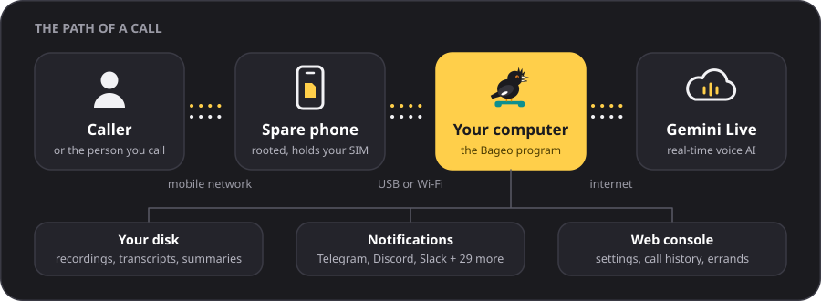

  

  <strong>English</strong> · <a href="README.zh-TW.md">繁體中文</a> · <a href="README.zh-CN.md">简体中文</a> · <a href="README.ja.md">日本語</a> · <a href="README.ko.md">한국어</a> · <a href="README.es.md">Español</a> · <a href="README.fr.md">Français</a> · <a href="README.de.md">Deutsch</a> · <a href="README.pt.md">Português</a>

  <strong>AI phone assistant for your real phone number: Gemini Live answers and makes your calls.</strong> 
  Self-hosted and open source. No rooted phone needed: a Linux computer with Bluetooth pairs with your phone, iPhone or Android. One program on your computer, your own Gemini key.

  
  
  
  

> **Bluetooth edition, in development.** Bageo over Bluetooth: a Linux computer with Bluetooth answers your phone's calls the way a car does, so the phone needs no root and no app, and iPhones work too. Texts and the urgent three-way call are not in this edition. Setup: [bluetooth/README.md](bluetooth/README.md).

<table>
  <tr>
    <td width="25%" align="center" valign="top">
       
      <strong>Answers your calls</strong> 
      Picks up after one ring, talks like a person and waits for the caller to say goodbye.
    </td>
    <td width="25%" align="center" valign="top">
       
      <strong>Stalls scammers</strong> 
      Spots sales and scam calls, then plays a slow, curious customer for up to 30 minutes.
    </td>
    <td width="25%" align="center" valign="top">
       
      <strong>Runs your errands</strong> 
      Write one line and it makes the call for you. When unsure, it asks you first.
    </td>
    <td width="25%" align="center" valign="top">
       
      <strong>Speaks nine languages</strong> 
      English, Traditional and Simplified Chinese, Japanese, Korean, Spanish, French, German and Portuguese. It switches when the caller does.
    </td>
  </tr>
</table>

The name comes from bāgē (八哥), the crested myna, a bird that learns to talk like the people it lives with.

## Try it: guess what Bageo says

Open a call, then click through it line by line. Scripted examples, not real call recordings.

<strong>Package delivery</strong> — A package arrives while you’re busy.

 

> <strong>Caller</strong>: Your package is here.

What does Bageo say?

 

> <strong>Bageo</strong>: Hi, I’m an AI assistant answering this phone. Does it need a signature in person?
>
> <strong>Caller</strong>: Yes. We can deliver again before five this afternoon.

And then?

 

> <strong>Bageo</strong>: I’ll pass that on and ask the recipient to confirm a time.

<strong>What you get:</strong> Signature needed; another delivery is possible before 5 pm. You confirm the time.

<strong>Sales pitch</strong> — A “special offer” is calling.

 

> <strong>Caller</strong>: You’re approved for a low-interest loan today!

Does Bageo hang up?

 

> <strong>Bageo</strong>: Is that a monthly interest rate or an annual one?
>
> <strong>Caller</strong>: First, give me your personal details.

Does Bageo hand them over?

 

> <strong>Bageo</strong>: How do you calculate the fees? How much is the monthly payment?

<strong>What you get:</strong> No personal details shared, and the questions keep coming. Bageo can keep a caller like this busy for up to 30 minutes.

<strong>Book a table</strong> — One instruction. One less call.

 

> <strong>You</strong>: Book four seats tomorrow at 7 pm. 7:30 is fine too.

How does Bageo open?

 

> <strong>Bageo</strong>: Hello, I’m an AI assistant calling to book a table for four tomorrow at seven.
>
> <strong>Restaurant</strong>: Seven is full. We have a table at seven thirty.

Does Bageo accept?

 

> <strong>Bageo</strong>: Seven thirty works. Please book it for four, thank you.
>
> <strong>Restaurant</strong>: Confirmed: tomorrow at seven thirty, four people.

<strong>What you get:</strong> Tomorrow, 7:30 pm, four people, within what you allowed. Anything outside your instructions, Bageo asks you first.

## A scammer calls. Bageo keeps them talking.

  

Once a call is clearly sales or a scam, the AI turns into an interested, slow, easily distracted customer. It asks about every detail, mishears the numbers and never gives out a real one, for up to 30 minutes, and you get the recording, the transcript and a short summary. Honest calls are left alone: a bank checking a card charge, a clinic, a courier, family. Stall Mode is on by default and one switch turns it off. [How the screening works](docs/en/FEATURES.md#spam-and-scam-call-blocker-with-stall-mode)

## Don't feel like calling? Write one line.

  

Book a table, move an appointment, ask a shop about stock or opening hours. When the other side raises something you did not cover, the AI asks you on screen before it answers. It never agrees to anything on its own: if you do not reply in time, it says you will confirm and ends the call politely. [More about AI errands](docs/en/FEATURES.md#ai-errands-it-makes-calls-for-you)

## A caller from abroad? Bageo speaks nine languages.

  

The AI's voice, the built-in prompts (a short, general baseline you can customize for your own situation and style), the web console and the notifications all come in nine languages. On a dual-SIM phone each SIM opens calls in its own language, a caller from abroad hears their country's language, and when a caller switches language mid-call, the AI follows. Transcripts keep the original words, each line with a translation into your notification language. [More about languages and dual SIM](docs/en/FEATURES.md#nine-languages-dual-sim-translated-transcripts)

## How it works

  

The phone only carries the call; everything else runs on your own computer. The AI connects while the phone is still ringing, so its first word comes about **0.43 s** after pick-up (measured median). One call, step by step: [Architecture](docs/en/ARCHITECTURE.md).

## Why Bageo

| | AI phone services on SIP trunks or virtual numbers | Bageo |
|---|---|---|
| **Number** | A number from the service, or your calls forwarded to it | The number you already have. Outgoing calls show it too. |
| **Cost** | A subscription or a per-minute rate | No platform fee. You pay Google for Gemini usage and your carrier for the SIM. |
| **Your data** | On the service's servers | Plain files in a `data/` folder on your own disk |
| **The catch** | Sign up and go | You need a Linux computer with Bluetooth next to your phone, and a computer that stays on |

## And there is more

<table>
  <tr>
    <td width="33%" align="center" valign="top">
       
      <strong>Appointments wait for you</strong> 
      With Appointments on, a caller who wants to set a time lands on your to-do list. You accept or decline; the AI calls them back.
    </td>
    <td width="33%" align="center" valign="top">
       
      <strong>Knows who is calling</strong> 
      Import contacts from vCard, Excel, PDF or a photo of a business card. Put each person on one of four lists: contact, Whitelist, Blacklist or stall list.
    </td>
    <td width="33%" align="center" valign="top">
       
      <strong>One switch back to a normal phone</strong> 
      Switch between the AI and a normal phone in the console. In normal phone mode, calls stay on your phone.
    </td>
  </tr>
  <tr>
    <td width="33%" align="center" valign="top">
       
      <strong>Sounds like a real call</strong> 
      Optional background sound: home, office, street, night market and eight more.
    </td>
    <td width="33%" align="center" valign="top">
       
      <strong>32 notification channels</strong> 
      A summary after every call on Telegram, Discord, Slack, LINE and more. Act on it with one tap in the notification, or send commands from the chat.
    </td>
    <td width="33%" align="center" valign="top">
       
      <strong>Your data stays yours</strong> 
      Recordings and transcripts are plain files on your own disk. No account with us.
    </td>
  </tr>
</table>

Every feature in detail: [Features](docs/en/FEATURES.md).

## What you need

1. **A phone with your SIM**, iPhone or Android. No root and no app on the phone.
2. **A Linux computer with Bluetooth** near the phone (about 10 m): Debian, Ubuntu or Raspberry Pi OS. It can be the same computer that runs Bageo.
3. **A computer that runs Bageo** while calls should be answered: Windows 10/11, macOS, Linux or Docker.
4. **A Gemini API key** from [Google AI Studio](https://aistudio.google.com/apikey). Google bills per use.

## Quick start

The Bluetooth computer needs Linux. Bageo itself also runs on Windows, macOS and Docker.

1. **Download** the file for your system from [Releases](https://github.com/h4lo-void/bageo-call-bluetooth/releases): `bageo-call-bluetooth-<version>-windows-x64-setup.exe` for Windows, `bageo-call-bluetooth-<version>-macos-arm64.dmg` (Apple chip) or `bageo-call-bluetooth-<version>-macos-x64.dmg` (Intel) for macOS, `bageo-call-bluetooth-<version>-linux-x64.tar.gz` for Linux. For Docker, build it from this repository: `docker compose up -d --build`.
2. **Install and start it.** Windows: double-click the `setup.exe` and click the **Bageo** shortcut on the desktop. macOS: open the `.dmg`, drag Bageo into Applications and click it. Linux: unpack and run `./start.sh`. The console opens at <http://localhost:8787/>, and <http://bageo.local/> also works on this computer and on the same Wi-Fi once a console password is set.
3. **Fill in the basics** under **Settings**: your Gemini API key, your name and the language. Press ▶ to hear the voices and pick one.
4. **Connect the phone** once: on the Bluetooth computer run `sudo ./bluetooth/install.sh` (it is in the Linux download) and pair your phone with it. If Bageo runs on another computer or in Docker, link the two with a pairing code from the console. Details: [bluetooth/README.md](bluetooth/README.md).
5. **Call it** from another phone: one ring, and the AI answers.

Stuck? Every step in detail: [Getting started](docs/en/GETTING_STARTED.md) · [Phone setup](bluetooth/README.md).

## Documentation

| | |
|---|---|
| **Start** | [Getting started](docs/en/GETTING_STARTED.md) · [Phone setup](bluetooth/README.md) · [Troubleshooting & FAQ](docs/en/TROUBLESHOOTING.md) |
| **Use** | [Features](docs/en/FEATURES.md) · [Chat commands & notifications control](docs/en/CHAT_COMMANDS.md) · [Writing the prompt](docs/en/PROMPTS.md) · [Settings reference](docs/en/SETTINGS.md) · [Notifications](docs/en/NOTIFICATIONS.md) |
| **Go deeper** | [Architecture](docs/en/ARCHITECTURE.md) · [API](docs/en/API.md) · [MCP](docs/en/MCP.md) · [Roadmap](docs/en/ROADMAP.md) · [Changelog](CHANGELOG.md) · [`bluetooth/`](bluetooth/README.md) |
| **Legal** | [Privacy, safety and the law](docs/en/PRIVACY_AND_LEGAL.md) · [Legal disclaimer & operator terms](LEGAL.md) · [Dual & commercial licensing](COMMERCIAL_LICENSE.md) · [Project security & compliance audit](AUDIT_REPORT.md) |

**Test status:** more than 1,400 automated tests in CI, 234 simulated calls in 28 languages, and real calls over Bluetooth on a Pixel 9. [Details](docs/en/FEATURES.md#test-status). Reports from other phones and languages help the most: [CONTRIBUTING.md](CONTRIBUTING.md).

## FAQ

<strong>Can an AI answer calls on my existing phone number?</strong>

Yes, that is what Bageo is for. Your phone pairs with a Linux computer over Bluetooth, the way it pairs with a car. The AI answers calls to your number and places calls from it. In normal phone mode, calls stay on the phone.

<strong>Does it work without root, or on an iPhone?</strong>

Yes, both. The phone needs no root and no app, and iPhone and Android both work. Bageo uses Bluetooth hands-free, the same thing a car uses.

<strong>Which phones and computers are supported?</strong>

Phones that pair with a car's hands-free system should work. Real calls have been tested on a Google Pixel 9; iPhone pairs too but has had less testing. The Bluetooth computer must run Linux (Debian, Ubuntu or Raspberry Pi OS); Windows and macOS can't be the Bluetooth computer, but Bageo itself runs on them. See [Bluetooth setup](bluetooth/README.md).

<strong>How much does it cost to run?</strong>

Bageo is free for personal and open-source use under `AGPL-3.0-only` (closed-source or commercial hosted operators need a [Commercial License](COMMERCIAL_LICENSE.md)). Google bills the Gemini Live audio per use for
every call the AI handles, incoming or outgoing; summaries are small text
requests to Gemini's lowest-cost model. Voice previews and the blocked-number
announcement are prerecorded and cost nothing. Add your phone plan and the
electricity for the computer, and set a budget in your Google account if you
want a ceiling.

<strong>Is it legal to let an AI answer my calls?</strong>

It depends on where you and the other side are. Call recording, AI disclosure
and automated outgoing calls all have their own rules. The *AI assistant*
style says it is an AI in its first sentence; *As me* speaks as you without
saying it is an AI. Read [Privacy, safety and the law](docs/en/PRIVACY_AND_LEGAL.md)
before you switch it on.

<strong>Does it work offline or without Google?</strong>

No. The live voice is Gemini Live, which needs an internet connection and a
Gemini key. Summaries can run on a local model through Ollama (see
[Summary & calendar](docs/en/SETTINGS.md#summary--calendar)); a fully local
voice stack is not part of the supported setup ([Roadmap](docs/en/ROADMAP.md)).

## Use it responsibly

- **Laws differ.** Recording calls, and letting an AI talk to people without
  telling them, is restricted in many places. The *AI assistant* answer style
  says it is an AI up front; errands made as **Your assistant** introduce the
  AI as your assistant; *As me* and **You in person** speak as you without
  disclosing. Find out what applies where you and the other side are.
- **The AI makes no commitments.** It never agrees to payments, deposits,
  contracts, passwords or codes, and appointments wait for your decision. It
  is still an AI: read the summaries and results.
- **Do not rely on it for emergencies.** Errands never dial emergency numbers.
- **This edition is in development.** Do not rely on it alone for calls that matter yet.

## License & Legal Disclaimer

**Dual-licensed** by **h4lo-void** (see [LICENSING.md](LICENSING.md)):

- **Open-Source Community License:** [GNU Affero General Public License v3.0 only (`AGPL-3.0-only`)](LICENSE), with the Section 7 additional terms in [LICENSING.md](LICENSING.md) — free for personal, academic, and open-source use. Modifying Bageo and letting others interact with it over a network or phone line requires releasing the complete corresponding source code under `AGPL-3.0-only`.
- **Obtain a Commercial License:** Operators, enterprises, SaaS/call-center providers, or hardware vendors who wish to deploy, embed, or host Bageo without `AGPL-3.0-only` source-code disclosure can obtain a separate written proprietary license — see [**Commercial License Terms**](COMMERCIAL_LICENSE.md).

**Disclaimer & local law:** Bageo is self-hosted software provided "AS IS" without warranty; the author operates no service and receives no user data. Whoever deploys it is responsible for complying with local laws on call recording, AI disclosure, and automated dialing, and for carrier/API charges. Read [**LEGAL.md**](LEGAL.md), [Privacy, safety and the law](docs/en/PRIVACY_AND_LEGAL.md), and the [v1.0 AI-assisted internal review note](AUDIT_REPORT.md) (`gemini-4-carbon`, not a third-party audit) before use. Third-party notices (including OpenCC `Apache-2.0` dictionaries) are in [NOTICE.md](NOTICE.md). Not affiliated with Google LLC, Apple Inc. or the Bluetooth SIG; Android and Gemini are trademarks of Google LLC, iPhone of Apple Inc., and Bluetooth of the Bluetooth SIG.

<!-- SPDX-FileCopyrightText: h4lo-void <https://github.com/h4lo-void/bageo-call> -->
